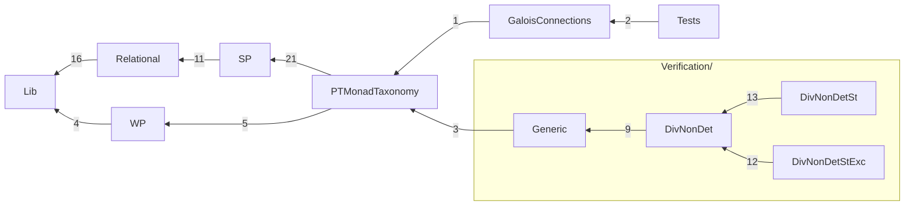

# The Rocq development

Mechanization of *A Taxonomy of Predicate Transformer Monads for Specifying
Monadic Programs*. Directories follow the paper; [Checks/PaperClaims.v](Checks/PaperClaims.v)
maps each claim to its Rocq names and checks them when `make check` runs.

## Build

Rocq/Coq 8.20 with `coq-ext-lib`, `coq-itree` and `coq-hammer-tactics`
(exact constraints: [coq-spec-monad.opam](coq-spec-monad.opam)).

```sh
make -j8        # the development (about 45 s on 8 cores)
make check      # assumption audit (Checks/Assumptions.v) and the claims index
make layers     # check that imports respect the directory layers
```

`make check` reports the axioms each selected theorem uses: functional and
propositional extensionality and, where stated, excluded middle
(`Classical_Prop.classic`); the ITree program layer also uses `eq_rect_eq`,
through ITree and paco.

## Layout

| Directory | Paper | Contents |
|---|---|---|
| [Lib/](Lib) | background | arrows with application and choice, the option/state arrow transformers, arrow morphisms, the monad of an arrow at a fixed input; ordered monads, monad morphisms and their composition (`∘ₘₘ`), monadic relations, monad-transformer laws; facts about the paths of interaction trees (`ITreeFacts.v`) |
| [Relational/](Relational) | infrastructure; `Pred` (§7) | proof infrastructure: relations as arrows, the four SP readings of a relation, the predicate monad `Pred` |
| [WP/](WP) | §2, §3.6 | `WPure` and its stacks; the WP variants AWP, DWLP, DWP, AWLP |
| [SP/](SP) | §3.1–3.5 | `SPost` and why its stateful extension fails; the SP arrows ASP, DSLP, DSP, ASLP; the four SP monads |
| [PTMonadTaxonomy/](PTMonadTaxonomy) | §4 | the taxonomy of predicate transformer (PT) monads: implication, contrapositive and Galois connection on bare transformers, then as monadic relations between the monads (Figure 1) |
| [Verification/](Verification) | §1, §5, §6 | everything that involves the computation monad `divndNE`, by setting; programs are interaction trees, denoted into it; each setting directory has the same files: `Computation.v`, `Morphisms.v`, `Triples.v`, `TriplesTaxonomy.v`, `DijkstraMonads.v`, `Typings.v`, `InCorrectnessPrinciples.v` (O'Hearn's rules), and examples in `TriplesExamples/` |
| ↳ [Generic/](Verification/Generic) | §5, §6 | what is the same at every setting: the general triple, the Dijkstra construction, triples as typings at any indices |
| ↳ [DivNonDet/](Verification/DivNonDet) | §1, §5, §6 | base setting: programs `itree E A` and their outcomes `divndNE`, `denote`; the readings defined once (`dwpPure`, `aspPure`, …) |
| ↳ [DivNonDetSt/](Verification/DivNonDetSt) | §5, §6 | with state, `stateT S divndNE`, programs `stateT S (itree E)` (`denoteSt`); the lifts (`dwpSt`, …); the diagram; the examples of O'Hearn's *Incorrectness Logic* ([TriplesExamples/IncorrectnessLogic.v](Verification/DivNonDetSt/TriplesExamples/IncorrectnessLogic.v)) |
| ↳ [DivNonDetStExc/](Verification/DivNonDetStExc) | §5, §6 | with state and exceptions, `stateT S (optionT divndNE)`, programs `stateT S (optionT (itree E))` (`denoteStExc`); the lifts (`dwpStExc`, …); the diagram; the examples |
| [GaloisConnections/](GaloisConnections) | §7 | the DM4All specification monads and their adjunctions |
| [Tests/](Tests) | — | regression and instance checks |
| [Checks/](Checks) | — | opt-in audits: assumptions and the paper claims |


