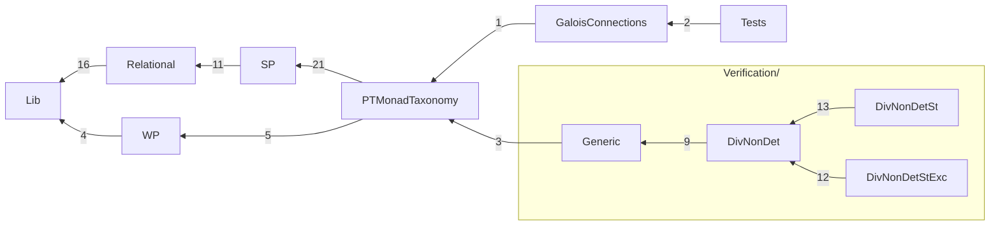

# The Rocq development

Mechanization of *A Taxonomy of Predicate Transformer Monads for Specifying
Monadic Programs*. Directories follow the paper; [PAPER.md](../PAPER.md) maps
each claim to its Rocq name, and [Checks/PaperClaims.v](Checks/PaperClaims.v)
checks those names when `make check` runs.

## Build

Rocq/Coq 8.20 with `coq-ext-lib`, `coq-itree` and `coq-hammer-tactics`
(exact constraints: [coq-spec-monad.opam](coq-spec-monad.opam)).

```sh
make -j8        # the development (about 45 s on 8 cores)
make check      # assumption audit (Checks/Assumptions.v) and the claims index
make layers     # check that imports respect the directory layers
```

`make check` reports the axioms each selected theorem uses: functional and
propositional extensionality and, where stated, excluded middle
(`Classical_Prop.classic`); the ITree program layer also uses `eq_rect_eq`,
through ITree and paco.

## Layout

| Directory | Paper | Contents |
|---|---|---|
| [Lib/](Lib) | background | arrows with application and choice, the option/state arrow transformers, arrow morphisms, the monad of an arrow at a fixed input; ordered monads, monad morphisms and their composition (`∘ₘₘ`), monadic relations, monad-transformer laws; facts about the paths of interaction trees (`ITreeFacts.v`) |
| [Relational/](Relational) | infrastructure; `Pred` (§7) | proof infrastructure: relations as arrows, the four SP readings of a relation, the predicate monad `Pred` |
| [WP/](WP) | §2, §3.6 | `WPure` and its stacks; the WP variants AWP, DWLP, DWP, AWLP |
| [SP/](SP) | §3.1–3.5 | `SPost` and why its stateful extension fails; the SP arrows ASP, DSLP, DSP, ASLP; the four SP monads |
| [PTMonadTaxonomy/](PTMonadTaxonomy) | §4 | the taxonomy of predicate transformer (PT) monads: implication, contrapositive and Galois connection on bare transformers, then as monadic relations between the monads (Figure 1) |
| [Verification/](Verification) | §1, §5, §6 | everything that involves the computation monad `divndNE`, by setting; programs are interaction trees, denoted into it; each setting directory has the same files: `Computation.v`, `Morphisms.v`, `Triples.v`, `TriplesTaxonomy.v`, `DijkstraMonads.v`, `Typings.v`, `InCorrectnessPrinciples.v` (O'Hearn's rules), and examples in `TriplesExamples/` |
| ↳ [Generic/](Verification/Generic) | §5, §6 | what is the same at every setting: the general triple, the Dijkstra construction, triples as typings at any indices |
| ↳ [DivNonDet/](Verification/DivNonDet) | §1, §5, §6 | base setting: programs `itree E A` and their outcomes `divndNE`, `denote`; the readings defined once (`dwpPure`, `aspPure`, …) |
| ↳ [DivNonDetSt/](Verification/DivNonDetSt) | §5, §6 | with state, `stateT S divndNE`, programs `stateT S (itree E)` (`denoteSt`); the lifts (`dwpSt`, …); the diagram; the examples of O'Hearn's *Incorrectness Logic* ([TriplesExamples/IncorrectnessLogic.v](Verification/DivNonDetSt/TriplesExamples/IncorrectnessLogic.v)) |
| ↳ [DivNonDetStExc/](Verification/DivNonDetStExc) | §5, §6 | with state and exceptions, `stateT S (optionT divndNE)`, programs `stateT S (optionT (itree E))` (`denoteStExc`); the lifts (`dwpStExc`, …); the diagram; the examples |
| [GaloisConnections/](GaloisConnections) | §7 | the DM4All specification monads and their adjunctions |
| [Tests/](Tests) | — | regression and instance checks |
| [Checks/](Checks) | — | opt-in audits: assumptions and the paper claims |



Edges implied by others are omitted; a label counts the direct imports
between the two directories (`python3 scripts/depgraph.py --mermaid`
regenerates this). Two edges deserve a word: `GaloisConnections/GaloisArr.v`
reuses the monotone carrier `MonotoneSPost` of
`PTMonadTaxonomy/TransformerRelations.v`, and `Tests/ArrowMonadInstances.v`
instantiates the arrow-level specification types of `GaloisConnections/`
(Tests also imports SP, Relational and Lib directly). `Checks/` is outside
the build and the graph. Each
directory imports only from the ones it reaches
([scripts/layers.txt](scripts/layers.txt)); `make layers` and CI check it.
`python3 scripts/depgraph.py` writes `depgraph.html`, an interactive
file-level graph with a directory-only view.

## Where to start reading

1. §2: [WP/WPure.v](WP/WPure.v), the familiar WP monad.
2. §3.1, §3.3: [SP/SPostMonad.v](SP/SPostMonad.v) and
   [SP/StatefulSPostCounterexample.v](SP/StatefulSPostCounterexample.v):
   the SP monad and why state breaks it.
3. §3.2: [Lib/Arrow/ArrowMonad.v](Lib/Arrow/ArrowMonad.v) (the monad of an
   arrow with application) and [Lib/Arrow/StateArrowT.v](Lib/Arrow/StateArrowT.v).
4. §3.4–3.5: [SP/SPostArr.v](SP/SPostArr.v), [SP/DSPASLPArr.v](SP/DSPASLPArr.v),
   then [SP/ASPMonad.v](SP/ASPMonad.v) and its three siblings; §3.6:
   [WP/WPVariants.v](WP/WPVariants.v).
5. §4: [PTMonadTaxonomy/TransformerRelations.v](PTMonadTaxonomy/TransformerRelations.v), then
   `Section Flavours` of [PTMonadTaxonomy/MonadTaxonomy.v](PTMonadTaxonomy/MonadTaxonomy.v).
6. §5: [Verification/DivNonDet/Morphisms.v](Verification/DivNonDet/Morphisms.v)
   (the readings, shared with §6), [Verification/DivNonDetSt/Morphisms.v](Verification/DivNonDetSt/Morphisms.v)
   (their lifts), [Verification/Generic/Triple.v](Verification/Generic/Triple.v),
   [Verification/DivNonDetSt/Triples.v](Verification/DivNonDetSt/Triples.v),
   [Verification/DivNonDetSt/TriplesTaxonomy.v](Verification/DivNonDetSt/TriplesTaxonomy.v),
   [Verification/DivNonDetStExc/TriplesExamples.v](Verification/DivNonDetStExc/TriplesExamples.v)
   (one file per example in [TriplesExamples/](Verification/DivNonDetStExc/TriplesExamples)).
7. §6: [Verification/Generic/DijkstraMonad.v](Verification/Generic/DijkstraMonad.v),
   [Verification/Generic/Typings.v](Verification/Generic/Typings.v),
   [Verification/DivNonDetStExc/DijkstraExamples.v](Verification/DivNonDetStExc/DijkstraExamples.v).
8. §7: [GaloisConnections/BaseGaloisConnections.v](GaloisConnections/BaseGaloisConnections.v).

`Backup/` (including the former `ITreeExamples/`) is outside the build.
