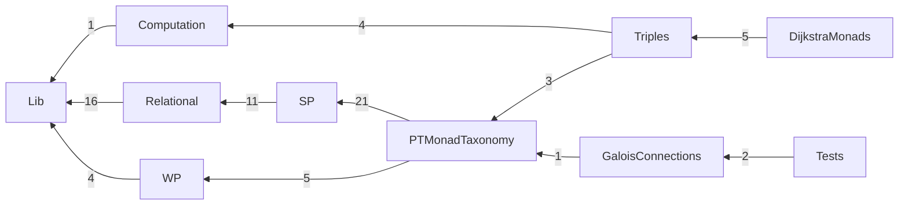

# The Rocq development

Mechanization of *A Taxonomy of Predicate Transformer Monads for Specifying
Monadic Programs*. Directories follow the paper; [PAPER.md](../PAPER.md) maps
each claim to its Rocq name, and [Checks/PaperClaims.v](Checks/PaperClaims.v)
checks those names when `make check` runs.

## Build

Rocq/Coq 8.20 with `coq-ext-lib`, `coq-itree` and `coq-hammer-tactics`
(exact constraints: [coq-spec-monad.opam](coq-spec-monad.opam)).

```sh
make -j8        # the development (about 35 s on 8 cores)
make check      # assumption audit (Checks/Assumptions.v) and the claims index
make layers     # check that imports respect the directory layers
```

`make check` reports the axioms each selected theorem uses: functional and
propositional extensionality and, where stated, excluded middle
(`Classical_Prop.classic`).

## Layout, in paper order

| Directory | Paper | Contents |
|---|---|---|
| [Lib/](Lib/CONTEXT.md) | background | arrows with application and choice, the option/state arrow transformers, arrow morphisms, the monad of an arrow at a fixed input; ordered monads, monad morphisms, monadic relations, monad-transformer laws |
| [Computation/](Computation/CONTEXT.md) | §1, §5 | `divndNE`, nondeterminism and nontermination, with state and with state and exceptions |
| [Relational/](Relational/CONTEXT.md) | infrastructure; `Pred` (§7) | proof infrastructure: relations as arrows, the four SP readings of a relation, the predicate monad `Pred` |
| [WP/](WP/CONTEXT.md) | §2, §3.6 | `WPure` and its stacks; the WP variants AWP, DWLP, DWP, AWLP |
| [SP/](SP/CONTEXT.md) | §3.1–3.5 | `SPost` and why its stateful extension fails; the SP arrows ASP, DSLP, DSP, ASLP; the four SP monads |
| [PTMonadTaxonomy/](PTMonadTaxonomy/CONTEXT.md) | §4 | the taxonomy of predicate transformer (PT) monads: implication, contrapositive and Galois connection on bare transformers, then as monadic relations between the monads (Figure 1) |
| [Triples/](Triples/CONTEXT.md) | §5 | monad morphisms out of `divndNE`, the general triple, the triple diagram, examples |
| [DijkstraMonads/](DijkstraMonads/CONTEXT.md) | §6 | Dijkstra monads of the morphisms; which triples are typings |
| [GaloisConnections/](GaloisConnections/CONTEXT.md) | §7 | the DM4All specification monads and their adjunctions |
| [Tests/](Tests/CONTEXT.md) | — | regression and instance checks |
| [Checks/](Checks/CONTEXT.md) | — | opt-in audits: assumptions and the paper claims |



Edges implied by others are omitted; a label counts the direct imports
between the two directories (`python3 scripts/depgraph.py --mermaid`
regenerates this). Two edges deserve a word: `GaloisConnections/GaloisArr.v`
reuses the monotone carrier `MonotoneSPost` of
`PTMonadTaxonomy/TransformerRelations.v`, and `Tests/ArrowMonadInstances.v`
instantiates the arrow-level specification types of `GaloisConnections/`
(Tests also imports SP, Relational and Lib directly). `Checks/` is outside
the build and the graph. Each
directory imports only from the ones it reaches
([scripts/layers.txt](scripts/layers.txt)); `make layers` and CI check it.
`python3 scripts/depgraph.py` writes `depgraph.html`, an interactive
file-level graph with a directory-only view.

## Where to start reading

1. §2: [WP/WPure.v](WP/WPure.v), the familiar WP monad.
2. §3.1, §3.3: [SP/SPostMonad.v](SP/SPostMonad.v) and
   [SP/StatefulSPostCounterexample.v](SP/StatefulSPostCounterexample.v):
   the SP monad and why state breaks it.
3. §3.2: [Lib/Arrow/ArrowMonad.v](Lib/Arrow/ArrowMonad.v) (the monad of an
   arrow with application) and [Lib/Arrow/StateArrowT.v](Lib/Arrow/StateArrowT.v).
4. §3.4–3.5: [SP/SPostArr.v](SP/SPostArr.v), [SP/DSPASLPArr.v](SP/DSPASLPArr.v),
   then [SP/ASPMonad.v](SP/ASPMonad.v) and its three siblings; §3.6:
   [WP/WPVariants.v](WP/WPVariants.v).
5. §4: [PTMonadTaxonomy/TransformerRelations.v](PTMonadTaxonomy/TransformerRelations.v), then
   `Section Flavours` of [PTMonadTaxonomy/MonadTaxonomy.v](PTMonadTaxonomy/MonadTaxonomy.v).
6. §5: [Triples/MonadMorphisms.v](Triples/MonadMorphisms.v),
   [Triples/TripleTaxonomy.v](Triples/TripleTaxonomy.v), [Triples/Examples.v](Triples/Examples.v).
7. §6: [DijkstraMonads/DijkstraMonad.v](DijkstraMonads/DijkstraMonad.v),
   [DijkstraMonads/DijkstraExamples.v](DijkstraMonads/DijkstraExamples.v).
8. §7: [GaloisConnections/BaseGaloisConnections.v](GaloisConnections/BaseGaloisConnections.v).

The [design notes](../docs/design.md) tell the longer story;
`Backup/` and `ITreeExamples/` are outside the build.
